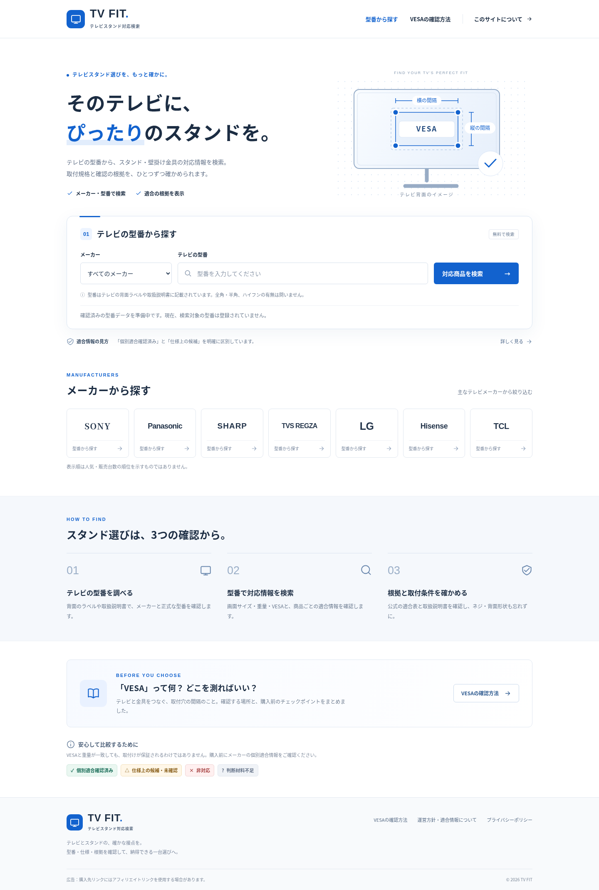

# テレビスタンド対応検索サイト

Astro・TypeScript・Tailwind CSS による静的サイトの MVP です。テレビの正式型番から、個別適合確認済み・仕様上の候補・非対応・判断材料不足を区別して表示します。確認済みの実在データはまだ提供されていないため、`data/` の本番 CSV はヘッダーのみです。検索・型番ページ・比較表はデータ投入後に利用できます。

テスト専用の架空データは `fixtures/` に隔離しています。本番の検索インデックス、生成 HTML、サイトマップには含めません。VESA と重量の一致だけで `confirmed` に変更する機能はありません。

## 開発環境

- Node.js **22.23.4 以上**。開発・CI では Node.js 24 を使用
- npm（`package-lock.json` を管理）
- Astro 7.4.7 / Tailwind CSS 4.3.5 / Fuse.js 7.5.0 / Zod 4.6.7
- Tailwind は `@tailwindcss/vite` で統合。静的出力のため Cloudflare アダプターやデータベースサーバーは不要

```sh
npm ci
cp .env.example .env
npm run dev
```

開発サーバーは通常 `http://localhost:4321` です。

ホームディレクトリが読み取り専用のクラウド環境では、`ASTRO_TELEMETRY_DISABLED=1 npm run dev` のように各 Astro コマンドのテレメトリーを無効にしてください。npm キャッシュも書き込み可能な作業ディレクトリに指定します（例：`npm_config_cache=/workspace/work/npm-cache npm ci`）。

```sh
npm run validate:data  # 本番 CSV の検証
npm run check          # Astro / TypeScript 型チェック
npm test               # 検索・データ検証・SEO・計測のテスト
npm run build          # CSV 検証後、dist/ に静的 HTML を生成
npm run verify:build   # 生成 HTML・XML・headers・架空データ混入を検証（ビルド後）
npm run preview        # 生成サイトのローカル確認
npm run verify         # 型チェック → テスト → 本番ビルド → 生成物検証
```

## 環境変数

| 変数 | 設定内容 |
| --- | --- |
| `PUBLIC_SITE_URL` | 本番サイトの HTTPS オリジン。末尾にパスを含めない。未設定時は `https://example.invalid` |
| `PUBLIC_INDEXING_ENABLED` | 検索インデックスを許可するときのみ `true`。未設定・`false` は全ページ `noindex` |
| `PUBLIC_GA4_MEASUREMENT_ID` | 任意の GA4 測定 ID（`G-...`）。未設定でもサイトは動作 |

これらはビルド時に使用します。変更後は再ビルドが必要です。`PUBLIC_` の値はブラウザーへ公開されるため、秘密情報を設定しないでください。

初期データが空の間は `PUBLIC_INDEXING_ENABLED=false` のまま運用してください。本番 URL を設定しても、それだけではインデックスを許可しません。

## ディレクトリ

```text
├── data/                  本番用 CSV（初期状態はヘッダーのみ）
├── fixtures/              架空と明記したテスト専用 CSV
├── src/
│   ├── components/        検索・商品一覧・比較 UI
│   ├── config/indexing.ts 内容重複等の手動 noindex 設定
│   ├── layouts/           共通レイアウト・メタ情報
│   ├── lib/               CSV 検証・検索・SEO・GA4
│   ├── pages/             トップ・型番別ページ・ガイド・XML 等
│   ├── scripts/           ブラウザーの検索・計測処理
│   └── styles/            Tailwind CSS・共通スタイル
├── scripts/               CSV 検証 CLI
├── tests/                 自動テスト
├── public/                favicon・Cloudflare 用ヘッダー等
├── docs/IMPLEMENTATION.md  工程別の実装と検証内容
└── .github/workflows/ci.yml
```

## CSV の管理

UTF-8 の CSV を使用し、列名・列順は以下に合わせてください。セルにカンマや改行がある場合は通常の CSV と同様にダブルクォートで囲みます。数値の単位は列名どおりです。

```csv
id,manufacturer,model,screen_inches,weight_kg,vesa_width_mm,vesa_height_mm,source_url
```

```csv
id,manufacturer,sku,stand_type,max_weight_kg,vesa_patterns,source_url,product_url
```

```csv
television_id,stand_id,status,evidence_type,evidence_url,checked_at,notes
```

### テレビ・スタンドの仕様

- `id` は変更しない内部識別子。正式型番は `model` / `sku` に原表記のまま保存します。
- `stand_type` は `floor`（床置き）、`tabletop`（卓上）、`wall`（壁掛け）のいずれか。
- `vesa_patterns` は `200x200;400x400` のように、幅と高さを小文字 `x`、複数パターンをセミコロンで区切ります。連続範囲の記号として使わず、確認できた穴間隔を列挙してください。
- テレビの未確認仕様は空欄にし、推測で埋めないでください。情報が不足した型番はインデックス対象から除外します。
- `weight_kg` は取付対象となるテレビ本体の重量を確認してください。付属卓上スタンド込みか、本体のみかを公式仕様で区別し、判断が必要な点は適合行の `notes` に記録します。
- `source_url` は公式仕様の参照先、`product_url` は購入先です。URL は HTTPS のみ許可し、認証情報付き URL や `javascript:` 等は拒否します。

### 適合区分と根拠

| `status` | 意味 | 運用 |
| --- | --- | --- |
| `confirmed` | メーカー等による、そのテレビと商品の個別適合確認済み | 個別確認の出典・確認日・注記が必須 |
| `candidate` | 仕様上の候補。個別適合は未確認 | VESA・重量が合っても対応を保証しない |
| `incompatible` | 明確な非対応 | 非対応と確認した根拠を記録 |
| `unknown` | 判断材料不足 | 根拠不足を非対応と扱わない |

`evidence_type` は `manufacturer_individual`、`official_individual`、`specification`、`insufficient` を使います。`confirmed` に使用できるのは前二者のみです。`checked_at` は実在する `YYYY-MM-DD` の日付にします。これは適合情報を確認した日であり、テレビ仕様の更新日ではありません。

CSV 検証は根拠の形式や欠落を検出しますが、参照先が本当にメーカー公式であるか、ページに個別適合が記載されているかまでは認証しません。運営者が原文を確認し、型番・対象商品・条件・出典・確認日を記録してから登録してください。

### データ追加の手順

1. テレビ・スタンドの公式仕様と個別適合情報を確認する。公開前に引用方法や情報の利用条件も確認する。
2. 原表記の型番、仕様、出典を `data/televisions.csv` / `stands.csv` に入力する。
3. `compatibility.csv` に組み合わせと根拠を記録する。情報がない組み合わせは `unknown` として扱う。
4. `npm run verify` を実行する。ID 重複、参照切れ、正規化衝突、URL、日付、適合根拠のエラーを解消する。
5. `npm run preview` で正式型番・適合区分・注意事項・公式リンク・比較表を確認する。
6. 本番用 CSV だけをコミットし、Cloudflare Pages で再ビルドする。

検索用の正規化は NFKC・大文字小文字・ハイフン等の差を吸収し、正式型番そのものは変更しません。同じメーカー内で正規化した型番が衝突した場合は、黙って統合せずビルドを止めます。URL はメーカー名・正式型番を NFKC と小文字化で整え、記号の連続をハイフンに置換して生成します。日本語等の文字は URL エンコードします。生成規則は `src/lib/data.ts` のルートヘルパーに集約しています。公開後にメーカー表記や正式型番を変更する場合は URL の変更とリダイレクトを確認してください。

## SEO と安全性

- 型番ページは CSV から `getStaticPaths()` で静的 HTML を生成します。
- ページ別 title・description・canonical、パンくず、実際の内容に沿った JSON-LD を出力します。架空の価格・レビュー評価は生成しません。
- サイトマップはインデックス許可済みページのみを掲載し、情報不足の型番・架空データ・404 等を除外します。
- 内容が重複する型番・別名・確認中のページは、`src/config/indexing.ts` の `indexExclusions` にテレビ ID と除外理由を登録します。ページは閲覧可能なまま `noindex` となり、サイトマップからも除外します。重複を自動で意味判定する仕組みではないため、編集時に内容を確認してください。
- プレビュー環境は `PUBLIC_INDEXING_ENABLED=false` にします。`robots.txt` のクロール許可と検索インデックス許可は別で、除外の中心はページの `noindex` です。
- VESA・耐荷重に加え、背面の凹凸、ネジ径・長さ、スペーサー、配線、壁下地等を確認するよう案内します。
- CSV の文字列は通常の Astro エスケープ、ブラウザーの検索結果は `textContent` で表示します。JSON-LD 等の埋め込みも安全にシリアライズします。
- 購入リンクには広告表記と `rel="sponsored nofollow noopener noreferrer"` を付けます。購入先 URL は運営者自身のアフィリエイト契約に従って登録してください。

## GA4

測定 ID が有効で、利用者が計測に同意した場合にのみ GA4 を読み込みます。未設定・未同意時も検索やページ表示は動作します。Do Not Track の設定を尊重します。同意状態はブラウザーの `localStorage`（`tv-stand:analytics-consent`）に `granted` / `denied` として保存します。

| イベント | 発生箇所 |
| --- | --- |
| `tv_search` | 型番検索の実行 |
| `tv_result_click` | 検索結果リンクの選択 |
| `affiliate_click` | 購入先リンクの選択 |
| `compatibility_view` | 同意後に適合情報が表示領域に入ったとき（各表示ブロックにつき 1 回） |

検索語の生データは送信せず、文字数・件数等を使用します。アフィリエイト URL のクエリ文字列や秘密情報もイベントへ含めません。公開前に運営者のプライバシー方針・GA4 設定・広告表記を実際の運用に合わせてください。

## 検証状況と任意のブラウザーテスト

納品時に Node.js 24.22.1 / npm 11.9.0 で依存関係のインストール、型チェック、自動テスト **70 件**、本番ビルド、生成物検証を実行しました。型チェックは 39 ファイルでエラー・警告・ヒント 0 件です。固定バージョン指定の `npm install` と、lockfile からの `npm ci` の両方が成功しています。詳細は [工程別の実装と検証](docs/IMPLEMENTATION.md) に記載しています。

Chromium がある環境では、通常の CI に加えて任意のブラウザーテストを実行できます。まず別ターミナルでプレビューを起動してください。

```sh
npm run preview -- --port 4321
```

続いて次を実行します。

```sh
node scripts/browser-smoke.mjs
```

`CHROMIUM_BIN`（既定 `/usr/bin/chromium`）、`SMOKE_ORIGIN`（既定 `http://127.0.0.1:4321`）、`SMOKE_OUTPUT_DIR`（既定 `work/browser`）で実行環境を変更できます。デスクトップとスマートフォンの表示・メーカー選択・未登録検索・ガイド遷移・測定 ID 未設定時の GA4 未送信・JavaScript/HTTP エラーを確認し、スクリーンショットを保存します。Chromium はこのリポジトリの npm 依存には含みません。

## GitHub と Cloudflare Pages への公開

本人限定で閲覧する Sites 版を用意しています。所有する GitHub リポジトリへの登録と Cloudflare Pages の一般公開は、以下の手順で行います。

1. GitHub に空のリポジトリを作成し、このプロジェクトをアップロードする。`.env`、`node_modules/`、`dist/` はコミットしない。
2. Cloudflare ダッシュボードで **Workers & Pages → Create application → Pages → Connect to Git** を選び、リポジトリを接続する。
3. 以下のビルド設定を登録する。

| 項目 | 値 |
| --- | --- |
| フレームワーク | Astro |
| 本番ブランチ | `main`（リポジトリに合わせて変更） |
| ルートディレクトリ | この `package.json` があるディレクトリ |
| ビルドコマンド | `npm run build` |
| 出力ディレクトリ | `dist` |
| `NODE_VERSION` | `24.22.1`、または要件を満たす Node.js 24 の安定版 |

4. Production の環境変数に `PUBLIC_SITE_URL=https://自分のドメイン` を設定する。確認済みコンテンツを登録し、公開内容をレビューするまでは `PUBLIC_INDEXING_ENABLED=false` にする。任意で `PUBLIC_GA4_MEASUREMENT_ID` を設定する。
5. Preview の環境変数には `PUBLIC_INDEXING_ENABLED=false` を明示する。本番値をコピーして `true` にしない。
6. デプロイ後に独自ドメインを接続し、HTTPS、canonical、`robots.txt`、`sitemap.xml`、スマートフォンの検索・比較表を確認する。
7. 確認済みデータと運用方針がそろった段階で Production の `PUBLIC_INDEXING_ENABLED=true` を設定し、再デプロイする。Google Search Console に本番サイトマップを登録する。

プレビューのアクセス制限や公開範囲は Cloudflare 側で必要に応じて設定してください。静的サイトなのでアダプター、Workers の実行環境、永続 DB は不要です。GitHub Actions は push / pull request で `npm ci` と `npm run verify` を実行します。

## 画面プレビュー

確認時のトップページです。本番用 CSV が空であることを案内しています。



[スマートフォンの表示](docs/screenshots/mobile.png)

## 公式ドキュメント

2026-11-08 に公式ドキュメントと npm の安定版を確認した構成です。依存バージョンは `package.json` と lockfile で固定しています。

- [Astro のインストールと必要な Node.js](https://docs.astro.build/en/install-and-setup/)
- [Astro の Tailwind CSS 統合](https://docs.astro.build/en/guides/styling/#tailwind)
- [Tailwind CSS の Vite プラグイン](https://tailwindcss.com/docs/installation/using-vite)
- [Cloudflare Pages の Astro 公開手順](https://developers.cloudflare.com/pages/framework-guides/deploy-an-astro-site/)

## 本人限定の閲覧版

Sites の本人限定サイトとして配信します。一般公開の Cloudflare Pages とは別の配信先です。

- 閲覧先： https://tv-fit-stand-search-mvp.workspace-240263.chatgpt.site
- 配信設定： `.openai/hosting.json`（静的 `dist`）
- 検索エンジンへの掲載：無効（`PUBLIC_INDEXING_ENABLED=false`）
- 実在する製品データ・GA4 測定 ID：未設定
- この版のビルド時には `PUBLIC_SITE_URL` に上記 URL を指定します。

`localhost` はブラウザーを開いている環境の住所です。お手元のブラウザーでは上の閲覧用 URL を使用してください。
